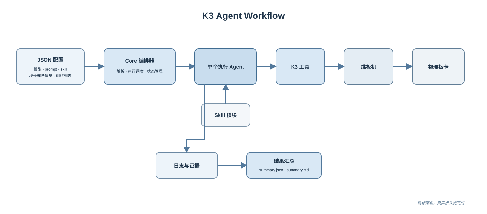

# K3 Agent Workflow

用 JSON 描述任务，由一个执行 agent 按 prompt 和 skill 操作板卡，最后汇总结果。core 只负责输入检查、串行调度、agent 生命周期和结果持久化，不需要 build agent，也不为每个测试新增脚本。

[](assets/k3-agent-workflow.drawio)

> 可编辑的 draw.io 源文件：[assets/k3-agent-workflow.drawio](assets/k3-agent-workflow.drawio)

## 当前可用范围

**精简 JSON 是待接入的目标配置，不是当前可直接执行的真机入口。** 当前仓库的 `scripts/workflow.py` 只支持旧格式的离线 plan/demo，不能启动真实 agent 或访问板卡；已有真实 live 入口仍限定为固定 UnixBench 任务。通用只读查询、精简配置与真实 worker 的接入尚未完成。

不要把示例直接传给旧入口，也不要将离线成功解释为真机测试通过。

## JSON 示例

仓库提供 [完整示例](examples/workflow/com260-smoke.json)：查询内核版本、内存大小和 COM260 型号。以下为同格式的单项版本：

```json
{
  "name": "com260-smoke",
  "agent": {"type": "pi", "provider": "openai-codex", "model": "gpt-6.1-sol"},
  "prompt": "只读查询指定板卡，保存原始输出和退出码；连接失败停止，不安装、不编译、不操作电源。",
  "skills": [{"name": "k3-status", "path": "/path/to/k3-auto/skills/k3-status/SKILL.md"}],
  "board": {
    "name": "com260",
    "jump": {"host": "JUMP_HOST", "port": 22, "user": "JUMP_USER", "password": "", "identityFile": "", "workingDirectory": "/path/on/jump/autolink_k3"},
    "ssh": {"host": "BOARD_HOST", "port": 22, "user": "BOARD_USER", "password": "", "identityFile": ""}
  },
  "tools": {"k3AutoRoot": "/path/to/k3-auto"},
  "tests": [{"name": "kernel", "prompt": "执行 uname -r 和 uname -m，要求版本非空且架构为 riscv64。"}],
  "outputDir": ".workflow/com260-smoke"
}
```

将示例复制成 `com260-smoke.local.json`，填写现场信息并设置权限为 `600`。所有 `*.local.json` 已忽略；不要将真实密码填入公开示例。模型认证使用 agent 自己的本机认证配置，不写进实验 JSON。示例模型需在执行环境中可用。

`board.jump` 是本机连接的跳板机，`board.ssh` 是从跳板机访问的板卡。skill 和工具路径属于本机，`workingDirectory` 属于跳板机。密码或密钥由连接工具使用，不传进模型 prompt；板卡密钥路径必须在实际发起板卡 SSH 的跳板机上可用。工具不支持的字段必须明确拒绝，不能静默忽略。

## 执行与可靠性约定

一轮启动一个 agent，顺序完成 `tests`。core 保留单 worker 互斥、输入与 skill 快照、幂等派发、持久状态以及中断隔离。工具负责资源占用与真实证据检查；状态不明时停止，不自动重跑。不能仅因 agent 返回成功就判定测试通过，也不能把结束本地 SSH 当作板端任务取消。

目标输出位于 `outputDir/<run-id>/`，相对路径以执行器启动目录为基准：

```text
request.json       脱敏输入
skills/            skill 快照
state.json         状态与资源归属
agent.jsonl        脱敏 agent 和工具事件
tasks/<name>/      各项原始输出、退出码、证据
summary.json       结构化结果与证据路径
summary.md         简短结论
```

上述是真实接入需满足的约定。当前离线锁仅覆盖同一状态目录，并非跨目录的全局板卡锁；不同 root 不能用于并行操作同一板卡。日志脱敏、远端取消和全局资源互斥仍须在真实接入时落实。

## 已有离线检查

以下命令使用旧格式 [offline.json](examples/workflow/offline.json)，不调用模型、不访问板卡、不编译：

```bash
PYTHONDONTWRITEBYTECODE=1 python3 tests/workflow.py
PYTHONDONTWRITEBYTECODE=1 python3 scripts/workflow.py validate --spec examples/workflow/offline.json
```

现有离线实现详见 [JSON workflow](docs/json-workflow.md)。其他技术文档描述保留的旧入口，不作为精简流程的真机运行指南。

现场实验记录、临时设计和图片制作说明保存在被忽略的 `.workflow/local-docs/`，不随仓库发布。原始日志保存在运行目录；公共文档不累积现场故障经过。
